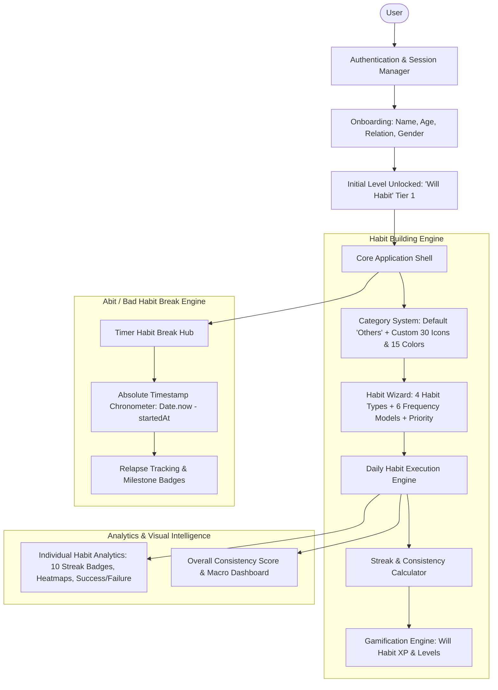
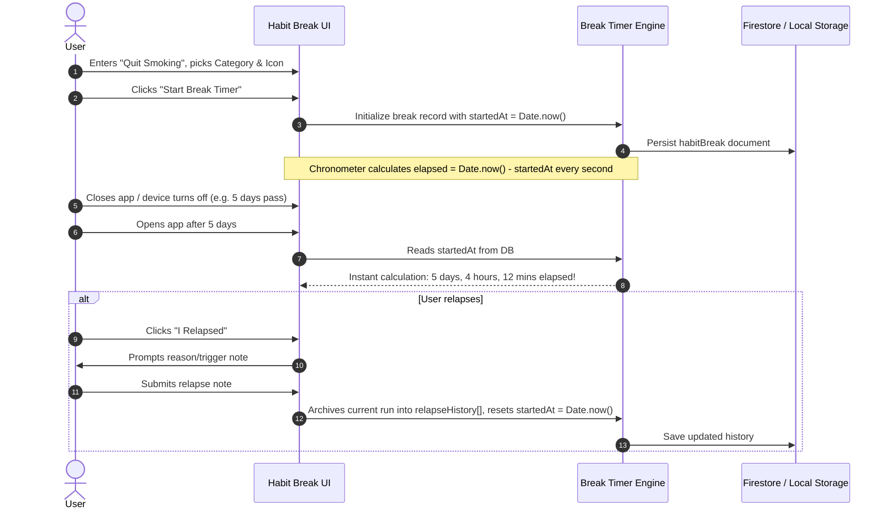
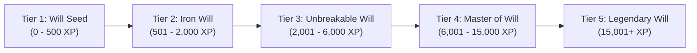

# 🏛️ HabitsSeen — Production-Ready System Architecture & Technical Specification

> **Project Name:** HabitsSeen (Smart Habit Tracker & Abstinence Timer)  
> **Design Philosophy:** Replicate Design System (Warm cream `#f9f7f3`, ink `#202020`, vibrant orange `#ea2804`, bone cards `#f3f0e8`, pill geometry)  
> **Status:** Production Architecture Specification  
> **Author & Architect:** AI Expert Software Engineering Team  

---

## 1. System High-Level Overview

HabitsSeen is an advanced, gamified habit tracking and behavioral modification application. It solves two complementary psychological goals:
1. **Habit Building (Positive Reinforcement):** Tracking daily routines across 4 distinct behavioral models (Yes/No, Numeric, Timer, Dynamic Checklist) with customizable recurrence rules, streak tracking, and a dynamic leveling system ("Will Habit").
2. **Habit Breaking (Negative Reinforcement / Abstinence):** A persistent, timestamp-driven stopwatch ("Timer Habit Break") tracking elapsed sobriety/abstinence from habits the user wants to quit, resilient to device reboots and app closures.



---

## 2. Tech Stack & Production Architecture Decisions

| Layer | Selected Technology | Technical Rationale |
|---|---|---|
| **Framework** | **Next.js 15 (App Router) / React 19** with TypeScript | Fast SSR/SSG, optimized font loading (`rb-freigeist-neue` / `basier-square` / `JetBrains Mono`), progressive web app capability. |
| **Styling & Design System** | **Tailwind CSS v4** + Design Tokens | Custom configured with tokens from `DESIGN-replicate.md` (warm cream canvas `#f9f7f3`, pure white card `#ffffff`, bone `#f3f0e8`, orange `#ea2804`, full pills). |
| **Icons & Micro-interactions** | **Lucide-React** + **Framer Motion** | 30 curated habit icons, smooth modal drawers, level-up confetti, and swipe-to-complete habit cards. |
| **State Management** | **Zustand** (with `persist` middleware) | Lightweight, zero-boilerplate client state. Offline-first optimistic updates that immediately sync to disk/storage. |
| **Time Engine** | **date-fns** & ISO-8601 UTC math | Strict timezone handling, leap years, recurrence matching, and zero-drift timestamp calculation. |
| **Data Layer (Repository Pattern)** | **Firebase Firestore & Auth Ready** | Structured Repository Interface (`IHabitRepository`, `IHabitBreakRepository`, `IUserRepository`). Decouples UI from Firebase so mocking, local testing, and actual Firebase plugging is zero friction. |

---

## 3. Core Domain Models & Database Schema (NoSQL / Firestore Ready)

The data model uses normalized subcollections under each user to ensure optimal read/write pricing, granular real-time listeners, and strict security rule enforcement.

```
firestore-root
│
├── users/{userId}
│     ├── categories/{categoryId}
│     ├── habits/{habitId}
│     │     └── logs/{dateKey} (e.g., '2026-10-11')
│     ├── habitBreaks/{breakId}
│     │     └── relapses/{relapseId}
│     └── gamification/
│           └── history/{logId}
```

### 3.1. User & Onboarding Profile (`users/{userId}`)

```typescript
export interface UserProfile {
  uid: string;
  email: string;
  displayName: string;
  avatarUrl?: string;
  
  // Onboarding Data
  onboarding: {
    isCompleted: boolean;
    name: string;
    age: number;
    relationStatus: 'single' | 'in_relationship' | 'married' | 'prefer_not_to_say';
    gender: 'male' | 'female' | 'non_binary' | 'other';
    completedAt: string; // ISO Timestamp
  };

  // Gamification ("Will Habit" Engine)
  gamification: {
    currentLevel: number;         // e.g. Level 1: "Will Habit Initiate"
    levelTitle: string;           // e.g. "Will Habit: Iron Focus"
    totalXp: number;              // Lifetime Experience Points
    currentLevelXp: number;       // XP progress within current level
    nextLevelXpRequired: number;  // XP needed for next level
    consistencyScore: number;     // 0 - 100% composite score
    globalCurrentStreak: number;  // Days active consecutively
    globalBestStreak: number;     // Best active streak
    badgesUnlocked: string[];     // IDs of unlocked achievements
  };

  createdAt: string;
  updatedAt: string;
}
```

---

### 3.2. Categories Catalog (`users/{userId}/categories/{categoryId}`)

Every user gets the default category `"Others"`. Users can add unlimited custom categories.

```typescript
export interface Category {
  id: string;
  name: string;
  icon: string;         // Lucide icon name, e.g., 'flame', 'book-open', 'dumbbell'
  color: string;        // Hex code from the 15 curated light colors palette
  isDefault: boolean;   // true for 'Others'
  sortOrder: number;
  createdAt: string;
}
```

#### Curated 30 Motivation & Habit Icons:
1. `flame` (Consistency/Passion)
2. `dumbbell` (Workout/Fitness)
3. `book-open` (Reading/Learning)
4. `droplet` (Hydration/Water)
5. `heart-pulse` (Cardio/Health)
6. `moon` (Sleep/Rest)
7. `sun` (Morning Routine)
8. `brain` (Mindfulness/Mental Health)
9. `apple` (Nutrition/Diet)
10. `coffee` (No-caffeine/Moderation)
11. `pen-tool` (Writing/Journaling)
12. `code` (Coding/Building)
13. `wallet` (Finance/Savings)
14. `music` (Creativity/Instruments)
15. `footprints` (Walking/Steps)
16. `target` (Focus/Deep Work)
17. `sparkles` (Self Care/Glow)
18. `shield-check` (Discipline/Purity)
19. `zap` (High Energy Tasks)
20. `smile` (Gratitude/Mood)
21. `clock` (Punctuality/Time Mgmt)
22. `leaf` (Outdoor/Nature)
23. `briefcase` (Career/Business)
24. `users` (Family & Relationships)
25. `palette` (Art/Design)
26. `bed` (Early Wakeup/Sleep Hygiene)
27. `trophy` (Competitions/Goals)
28. `compass` (Life Direction/Reflection)
29. `crosshair` (Aim/Precision)
30. `layout-grid` (Others / General)

#### Curated 15 Aesthetic Pastel / Light Colors:
1. `#FDE2E4` (Soft Blush Rose)
2. `#FFF1E6` (Warm Peach)
3. `#EDEDE9` (Bone Mist)
4. `#D6E2E9` (Powder Sky Blue)
5. `#BCD4E6` (Calm Glacier)
6. `#E2ECE9` (Sage Cream)
7. `#DFE7FD` (Lavender Fog)
8. `#F0E6EF` (Soft Heather)
9. `#FEF9C3` (Pale Lemon Sun)
10. `#DCFCE7` (Fresh Spring Mint)
11. `#E0F2FE` (Daylight Breeze)
12. `#EDE9FE` (Pale Lilac)
13. `#FAE8FF` (Sweet Orchid)
14. `#FFE4E6` (Light Coral)
15. `#F5F5F4` (Minimalist Bone Stone)

---

### 3.3. Habit Model (`users/{userId}/habits/{habitId}`)

Supports all 4 habit modes and 6 frequency rules.

```typescript
export type HabitType = 'YES_NO' | 'NUMERIC' | 'TIMER' | 'CHECKLIST';
export type NumericOperator = 'AT_LEAST' | 'LESS_THAN' | 'EXACTLY' | 'ANY_VALUE';
export type TimerOperator = 'AT_LEAST' | 'LESS_THAN' | 'ANY_VALUE';
export type PriorityLevel = 'HIGH' | 'MEDIUM' | 'LOW';

export type FrequencyType = 
  | 'EVERYDAY'
  | 'SPECIFIC_DAYS_OF_WEEK'
  | 'SPECIFIC_DAYS_OF_MONTH'
  | 'SPECIFIC_DAYS_OF_YEAR'
  | 'DAYS_PER_PERIOD'
  | 'INTERVAL_REPEAT';

export interface ChecklistItem {
  id: string;
  text: string;
  isStarred?: boolean; // Star mark condition
}

export interface Habit {
  id: string;
  userId: string;
  categoryId: string; // Foreign key to Category
  name: string;
  description?: string;
  type: HabitType;

  // Type Specific Configuration
  config: {
    // 1. Numeric Habit Config
    numeric?: {
      operator: NumericOperator;
      goal: number;
      unit: string; // e.g. 'glasses', 'pages', 'km'
      suffix: 'a day'; // fixed display tag
    };

    // 2. Timer Habit Config
    timer?: {
      operator: TimerOperator;
      targetSeconds: number; // e.g. 1800 for 30 minutes
    };

    // 3. Checklist Habit Config
    checklist?: {
      items: ChecklistItem[];
      successCondition: 'ALL_MANDATORY' | 'CUSTOM_MIN_ITEMS' | 'STARRED_ONLY';
      customMinCount?: number; // if successCondition === 'CUSTOM_MIN_ITEMS'
    };
  };

  // Frequency ("How often do you want to do it")
  frequency: {
    type: FrequencyType;
    // For 'SPECIFIC_DAYS_OF_WEEK': [0, 1, 2, 3, 4, 5, 6] (0 = Sunday, 1 = Monday ...)
    daysOfWeek?: number[];
    // For 'SPECIFIC_DAYS_OF_MONTH': [1, 15, 30] (Day numbers 1..31)
    daysOfMonth?: number[];
    // For 'SPECIFIC_DAYS_OF_YEAR': ['01-01', '12-25', '10-11'] (MM-DD)
    daysOfYear?: string[];
    // For 'DAYS_PER_PERIOD': { count: 3, period: 'WEEK' | 'MONTH' | 'YEAR' }
    daysPerPeriod?: {
      targetCount: number;
      period: 'WEEK' | 'MONTH' | 'YEAR';
    };
    // For 'INTERVAL_REPEAT': every N days
    repeatEveryDays?: number;
  };

  // Scheduling & Window
  schedule: {
    startDate: string; // YYYY-MM-DD
    endDate?: string;  // YYYY-MM-DD (optional or bounded)
    totalDays: number; // Automatically calculated difference in days
    priority: PriorityLevel;
  };

  // Real-time Cached Statistics
  stats: {
    currentStreak: number; // in days
    bestStreak: number;    // in days
    timesCompletedThisWeek: number;
    timesCompletedThisMonth: number;
    timesCompletedThisYear: number;
    timesCompletedAllTime: number;
    totalTrackedDays: number;
    completionRate: number; // percentage (0 - 100)
    unlockedChallenges: number[]; // e.g. [1, 7, 10, 15, 30]
  };

  isArchived: boolean;
  createdAt: string;
  updatedAt: string;
}
```

---

### 3.4. Daily Execution Log (`users/{userId}/habits/{habitId}/logs/{dateKey}`)

A record created whenever a habit is logged or evaluated for a date (`dateKey` formatted as `YYYY-MM-DD`).

```typescript
export type HabitLogStatus = 'COMPLETED' | 'PARTIAL' | 'SKIPPED' | 'FAILED';

export interface HabitLog {
  date: string; // YYYY-MM-DD
  habitId: string;
  status: HabitLogStatus;
  
  // Value recorded depending on type:
  valueYesNo?: boolean;
  valueNumeric?: number;
  valueTimerSeconds?: number;
  valueChecklistCompletedItemIds?: string[];
  
  notes?: string;
  xpEarned: number;
  loggedAt: string; // ISO Timestamp
}
```

---

### 3.5. "Timer Habit Break" Model (`users/{userId}/habitBreaks/{breakId}`)

Specialized subsystem for breaking bad habits (sobriety, dopamine detox, screen addiction, smoking, nail biting).



```typescript
export interface RelapseRecord {
  id: string;
  endedAt: string; // ISO Timestamp
  durationSeconds: number; // How long user held before relapsing
  reason?: string;
  lessonLearned?: string;
}

export interface HabitBreak {
  id: string;
  userId: string;
  name: string;             // e.g. "Quit Sugar / Smoking"
  categoryId: string;       // Foreign key
  icon: string;             // e.g. "shield-check", "flame", "crosshair"
  color: string;            // Hex code
  description?: string;
  
  // Persistent Chronometer Engine
  startedAt: string;        // ISO Timestamp or Unix epoch ms (e.g. 1760171858000)
  currentStreakSeconds: number; // Computed dynamically: (Date.now() - startedAt) / 1000
  bestStreakSeconds: number;    // All-time longest abstinence streak
  
  // Milestones & Trophies
  unlockedMilestones: number[]; // e.g. [86400 (1d), 604800 (1w), 2592000 (1mo)]
  
  // Relapse & Journaling History
  relapseHistory: RelapseRecord[];
  
  isArchived: boolean;
  createdAt: string;
  updatedAt: string;
}
```

---

## 4. Gamification Engine: "Will Habit" Tier & Points Algorithm

The **"Will Habit"** badge is unlocked immediately upon completing the onboarding. It transforms mundane task execution into an engaging progression loop.

### 4.1. Level Hierarchy & Badge Titles



### 4.2. Daily Scoring & XP Formula

Every interaction awards or adjusts points:

$$\text{XP}_{\text{earned}} = \text{Base XP} \times \text{Streak Multiplier} \times \text{Priority Weight}$$

Where:
* **Base Completion:** $+50\text{ XP}$ per completed habit.
* **Partial Checklist Completion:** $+20\text{ XP}$.
* **Streak Multiplier:**
  * Days 1–6: $1.0\times$
  * Days 7–14: $1.25\times$
  * Days 15–29: $1.5\times$
  * Days 30+: $2.0\times$ (Maximum flow state bonus)
* **Priority Weight:**
  * High: $1.5\times$
  * Medium: $1.0\times$
  * Low: $0.75\times$
* **Negative Impact (Skipped / Failed):**
  * Consciously Skipped (Reason given): $-10\text{ XP}$ (Consistency score dips slightly, streak frozen if freeze token active).
  * Unlogged / Missed Day: $-25\text{ XP}$ (Streak reset).

### 4.3. Consistency Score Index (0–100%)
Calculated as a rolling 30-day exponential moving average:
$$\text{Consistency} = \left(\frac{\text{Completed Scheduled Days}}{\text{Total Required Scheduled Days}}\right) \times 100$$

---

## 5. Habit Frequency & Evaluation Engine

The core scheduling engine calculates whether a habit is **due today** and whether its success condition is met.

### 5.1. Frequency Matcher Algorithm

```typescript
export function isHabitDueOnDate(habit: Habit, targetDate: Date): boolean {
  const { startDate, endDate } = habit.schedule;
  const targetISO = format(targetDate, 'yyyy-MM-dd');

  // Check Schedule Bounds
  if (targetISO < startDate) return false;
  if (endDate && targetISO > endDate) return false;

  const { type, daysOfWeek, daysOfMonth, daysOfYear, daysPerPeriod, repeatEveryDays } = habit.frequency;

  switch (type) {
    case 'EVERYDAY':
      return true;

    case 'SPECIFIC_DAYS_OF_WEEK': {
      // 0 = Sunday, 1 = Monday ... 6 = Saturday
      const day = targetDate.getDay();
      return daysOfWeek?.includes(day) ?? false;
    }

    case 'SPECIFIC_DAYS_OF_MONTH': {
      const dayOfMonth = targetDate.getDate();
      return daysOfMonth?.includes(dayOfMonth) ?? false;
    }

    case 'SPECIFIC_DAYS_OF_YEAR': {
      const monthDay = format(targetDate, 'MM-dd');
      return daysOfYear?.includes(monthDay) ?? false;
    }

    case 'DAYS_PER_PERIOD':
      // Flexible goal: User must complete N times within the period window
      return true; // Marked due until weekly/monthly target reached

    case 'INTERVAL_REPEAT': {
      // Repeat every N days from startDate
      const start = new Date(startDate);
      const diffInDays = differenceInCalendarDays(targetDate, start);
      if (diffInDays < 0) return false;
      const interval = repeatEveryDays || 1;
      return diffInDays % interval === 0;
    }

    default:
      return true;
  }
}
```

### 5.2. Success Condition Evaluation Across All 4 Types

```typescript
export function evaluateHabitCompletion(habit: Habit, input: any): { isSuccess: boolean; progress: number } {
  switch (habit.type) {
    case 'YES_NO':
      return { isSuccess: Boolean(input.value), progress: input.value ? 1 : 0 };

    case 'NUMERIC': {
      const { operator, goal } = habit.config.numeric!;
      const current = Number(input.value) || 0;
      let ok = false;
      if (operator === 'AT_LEAST') ok = current >= goal;
      else if (operator === 'LESS_THAN') ok = current < goal;
      else if (operator === 'EXACTLY') ok = current === goal;
      else if (operator === 'ANY_VALUE') ok = current > 0;
      return { isSuccess: ok, progress: Math.min(1, current / goal) };
    }

    case 'TIMER': {
      const { operator, targetSeconds } = habit.config.timer!;
      const current = Number(input.durationSeconds) || 0;
      let ok = false;
      if (operator === 'AT_LEAST') ok = current >= targetSeconds;
      else if (operator === 'LESS_THAN') ok = current < targetSeconds;
      else if (operator === 'ANY_VALUE') ok = current > 0;
      return { isSuccess: ok, progress: Math.min(1, current / targetSeconds) };
    }

    case 'CHECKLIST': {
      const { items, successCondition, customMinCount } = habit.config.checklist!;
      const completedIds: string[] = input.completedItemIds || [];
      
      if (successCondition === 'ALL_MANDATORY') {
        const ok = items.every(it => completedIds.includes(it.id));
        return { isSuccess: ok, progress: completedIds.length / items.length };
      } 
      else if (successCondition === 'STARRED_ONLY') {
        const starred = items.filter(it => it.isStarred);
        const ok = starred.every(it => completedIds.includes(it.id));
        return { isSuccess: ok, progress: completedIds.length / items.length };
      } 
      else { // CUSTOM_MIN_ITEMS
        const minReq = customMinCount || 1;
        const ok = completedIds.length >= minReq;
        return { isSuccess: ok, progress: Math.min(1, completedIds.length / minReq) };
      }
    }
  }
}
```

---

## 6. Detailed Analytics & Streak Challenge Specifications

Each habit features dedicated analytics and gamified trophies.

### 6.1. The 10 Streak Challenge Milestones

| Badge Milestone | Trophy Name | Psychological Impact |
|---|---|---|
| **1 Day** | *The Spark* | Overcoming initial resistance and starting. |
| **7 Days** | *One-Week Strong* | Surviving the critical first weekend. |
| **10 Days** | *Double Digits* | Building momentum beyond novelty. |
| **15 Days** | *Half-Month Fortitude* | Neural pathway reinforcement. |
| **30 Days** | *Monthly Master* | Full habit crystallization milestone. |
| **60 Days** | *Two-Month Transformer* | Autonomous habit loop formed (Lally et al.). |
| **100 Days** | *Centurion of Will* | Elite consistency tier achieved. |
| **200 Days** | *Unwavering Pillar* | Long-term identity transformation. |
| **365 Days** | *Year of Triumph* | Complete seasonal cycle conquered. |
| **500 Days** | *Legendary Monk* | Top 0.1% dedication tier. |

### 6.2. Individual Habit Analytics Metrics:
1. **Streaks:** Current Streak (in days) vs. Best Streak (in days).
2. **Periodic Completion Totals:**
   - Completed This Week
   - Completed This Month
   - Completed This Year
   - Completed All Time
3. **Success vs. Failure Distribution:** Interactive Pie/Donut Chart showing:
   - Green: Target Exceeded / Met
   - Amber: Partial / Custom Met
   - Slate: Consciously Skipped
   - Crimson: Missed / Failed
4. **Git-Style 365-Day Activity Heatmap:**
   - Visual matrix with intensity based on completed percentage or goal volume.
5. **Interactive Calendar View:**
   - Day-by-day check-in inspection with tap-to-edit notes or logs.

---

## 7. UI / UX Design & Screen Breakdown (Replicate Token System)

Aligned with `DESIGN-replicate.md`:
* **Background Canvas:** `{colors.canvas}` (`#f9f7f3`)
* **Cards & Containers:** `{colors.surface-card}` (`#ffffff`) and `{colors.surface-bone}` (`#f3f0e8`)
* **Primary Stamp CTA:** `{colors.primary}` (`#ea2804`) with `{colors.on-primary}` (`#ffffff`)
* **Interactive Elements:** Fully rounded `{rounded.full}` (9999px pill shapes for buttons, chips, tags, inputs)
* **Code & Numeric Well:** `{typography.code-md}` with `JetBrains Mono`

```
┌───────────────────────────────────────────────────────────────┐
│ [HABITSSEEN]   Level 4: "Will Habit Master"   [+ Add Habit]  │
├───────────────────────────────────────────────────────────────┤
│ [📅 Mon 11]  [Tue 12]  [Wed 13]  [Thu 14]  [Fri 15]  [Sat 16] │
├───────────────────────────────────────────────────────────────┤
│ CATEGORIES: (● All)  (● Fitness)  (● Mind)  (● Break Bad)     │
├───────────────────────────────────────────────────────────────┤
│ ACTIVE HABITS TODAY:                                          │
│ ┌───────────────────────────────────────────────────────────┐ │
│ │ 🏋️ Morning Pushups [Numeric: 50 a day]           [40/50] │ │
│ │ [ -10 ]  [ +10 ]                       🔥 14 Days Streak  │ │
│ └───────────────────────────────────────────────────────────┘ │
│ ┌───────────────────────────────────────────────────────────┐ │
│ │ ⏱️ Meditation [Timer: At least 20m a day]         [15:00] │ │
│ │ [ ▶ Start Timer ]                      🔥 28 Days Streak  │ │
│ └───────────────────────────────────────────────────────────┘ │
│                                                               │
│ QUIT HABIT CHRONOMETER (Timer Habit Break):                  │
│ ┌───────────────────────────────────────────────────────────┐ │
│ │ 🚭 No Smoking Break                                        │ │
│ │ ⏱️ 14 Days : 06 Hours : 42 Mins : 18 Secs                  │ │
│ │ [Relapse Reset]                       🏆 Milestone: 7d Met│ │
│ └───────────────────────────────────────────────────────────┘ │
└───────────────────────────────────────────────────────────────┘
```

---

## 8. Modular Directory Structure (Production Ready)

```
d:\CAREER\Apps\Arigato Labs\HabitsSeen\
├── src/
│   ├── app/
│   │   ├── (auth)/
│   │   │   ├── login/page.tsx
│   │   │   └── onboarding/page.tsx
│   │   ├── (dashboard)/
│   │   │   ├── page.tsx                    # Main habits view & date switcher
│   │   │   ├── habit-break/page.tsx        # "Timer Habit Break" quit hub
│   │   │   ├── analytics/page.tsx          # Global analytics & consistency
│   │   │   └── habits/[id]/page.tsx        # Single habit stats & calendar
│   │   ├── layout.tsx
│   │   └── globals.css
│   ├── components/
│   │   ├── ui/                             # Buttons, Inputs, Modals, Pills (Replicate tokens)
│   │   ├── habit-creation/
│   │   │   ├── Step1Category.tsx           # Category chooser & 30 icons + 15 colors
│   │   │   ├── Step2HabitType.tsx          # Yes/No, Numeric, Timer, Checklist forms
│   │   │   ├── Step3Frequency.tsx          # Everyday, Specific days, etc.
│   │   │   └── Step4SchedulePriority.tsx   # Start/End date duration & priority
│   │   ├── habits/
│   │   │   ├── HabitCard.tsx               # Interactive item card with fast check-in
│   │   │   └── HabitBreakChronometer.tsx   # Persistent abstinence live counter
│   │   ├── analytics/
│   │   │   ├── HeatmapCalendar.tsx         # 365-day git style activity
│   │   │   ├── StreakChallengeRack.tsx     # 10 milestone badges (1d..500d)
│   │   │   └── SuccessFailureChart.tsx     # Recharts donut / breakdown
│   │   └── gamification/
│   │       ├── WillHabitBadge.tsx          # Dynamic Level Badge display
│   │       └── LevelUpModal.tsx            # Confetti & unlock dialogue
│   ├── stores/
│   │   ├── useHabitStore.ts                # Zustand habits & logs store
│   │   ├── useHabitBreakStore.ts           # Persistent timer habit break store
│   │   └── useGamificationStore.ts         # XP & "Will Habit" badge store
│   ├── services/
│   │   ├── IHabitRepository.ts             # Clean Repository Interface
│   │   ├── MockHabitRepository.ts          # Offline local storage implementation
│   │   └── FirebaseHabitRepository.ts      # (To plug user's Firebase code)
│   ├── utils/
│   │   ├── dateMath.ts                     # Recurrence & duration calculations
│   │   ├── streakEngine.ts                 # Streak & milestone detection
│   │   └── designTokens.ts                 # Replicate color/typography constants
│   └── types/
│       └── habit.ts                        # Shared TypeScript schemas
├── DESIGN-replicate.md                     # Extracted design specification
├── package.json
└── tsconfig.json
```

---

## 9. Firebase Security Rules & Indexing Strategy

When Firebase code is connected, the following security blueprint protects all user records:

```javascript
rules_version = '2';
service cloud.firestore {
  match /databases/{database}/documents {
    match /users/{userId} {
      allow read, write: if request.auth != null && request.auth.uid == userId;
      
      match /categories/{categoryId} {
        allow read, write: if request.auth != null && request.auth.uid == userId;
      }
      match /habits/{habitId} {
        allow read, write: if request.auth != null && request.auth.uid == userId;
        
        match /logs/{dateKey} {
          allow read, write: if request.auth != null && request.auth.uid == userId;
        }
      }
      match /habitBreaks/{breakId} {
        allow read, write: if request.auth != null && request.auth.uid == userId;
        
        match /relapses/{relapseId} {
          allow read, write: if request.auth != null && request.auth.uid == userId;
        }
      }
    }
  }
}
```

---

## 10. Summary & Immediate Next Steps

This architecture provides:
1. **100% Feature Completeness:** Handles every detail requested (Onboarding questionnaire, "Will Habit" badge, Category system with 30 icons + 15 colors, 4 Habit Types with exact field constraints, 6 Frequency configurations, dynamic duration calculation, 10 Streak Challenge Badges, Individual Habit Analytics & Calendar, and the persistent "Timer Habit Break" stopwatch).
2. **Replicate Design Alignment:** Directly utilizes the aesthetic specifications from `DESIGN-replicate.md` (warm cream canvas, bold orange CTAs, rounded-full pills, JetBrains Mono numbers).
3. **Pluggable Firebase Architecture:** Built using the Repository Pattern so the client application functions immediately with local persistence and smoothly links to Firebase once you provide the credentials/SDK configuration.
